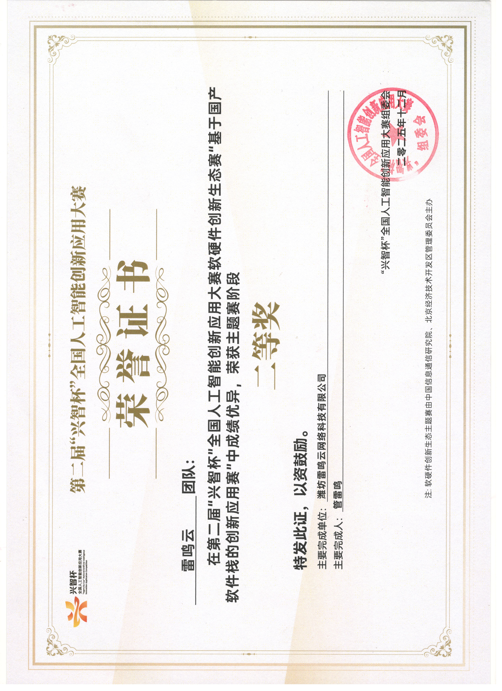

## 简介
它是一个自动营销推广的机器人，集成了我们十余年的技术成果，提供自动化营销推广能力。  
具体的详细说明，可以查阅网站 https://bizbot.zvo.cn  

## 你有技术有产品，它帮你推广出去
可能你技术很好，你的产品也很棒，但是苦于知道的人太少，再好的产品也发挥不了价值，然后逐渐被埋没！  
作为一个一直搞开源的老技术， 深知其中的痛苦，于是我们专门做了这个，专门针对技术人员，弥补技术在推广方面的缺陷，AI时代，应该是技术人员的最先拥抱，最好的机会。  

## 它也可以接入你现有的产品
比如你有CRM、ERP ......  等等产品，可以跟他快速对接，它提供API对接接口，可以吧寻找的客户数据、自动聊天的数据等直接对接到你自己的系统中，成为你自己系统的一部分。  

## Linux 部署
你可以弄个 Ubuntu ， 22、24版本的都行，1核2G就够用，执行脚本一键部署：

````
curl -fsSL https://down.zvo.cn/bizbot/centos7/install.sh -o install.sh && chmod 777 install.sh && ./install.sh
````  
有关更多的详细说明，可以参考：  [https://bizbot.zvo.cn/index.html#deployment](https://bizbot.zvo.cn/index.html#deployment)


## 使用截图
### Android 端


### WEB端


# 关于我们
作者：管雷鸣  
邮箱：921153866@qq.com  
微信：17076012262  
  

