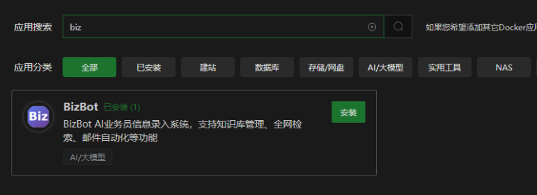

# BizBot 
它是一个自动营销推广的机器人。提供全模态的自动化营销推广能力。  
  
1. 全网检索，跟自己有合作、成交、长下游、等关系的目标。
1. 自我进化，用的越久，参与越多，它永久记忆。时间越长，它聊客户会越像你。
1. 拟人化。 完全以人的角度去出发去分析。它代替你去找客户、跟对方聊商机，对方感知你就是一个人。


# 私有部署
当前已集成到宝塔中进行一键安装使用，可直接在宝塔中搜索 ````BizBot```` 即可找到，进行安装使用。  
