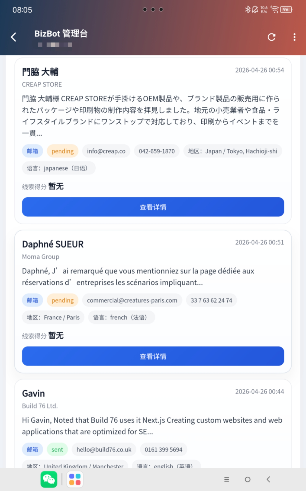
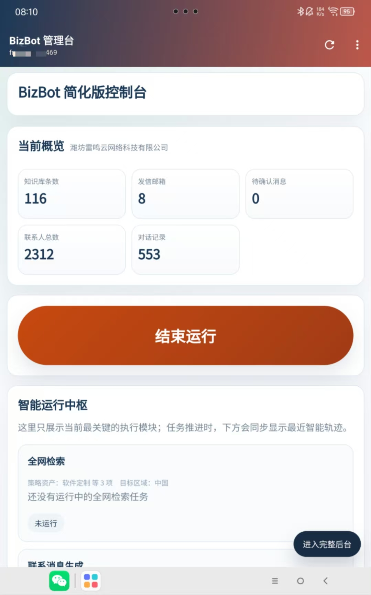
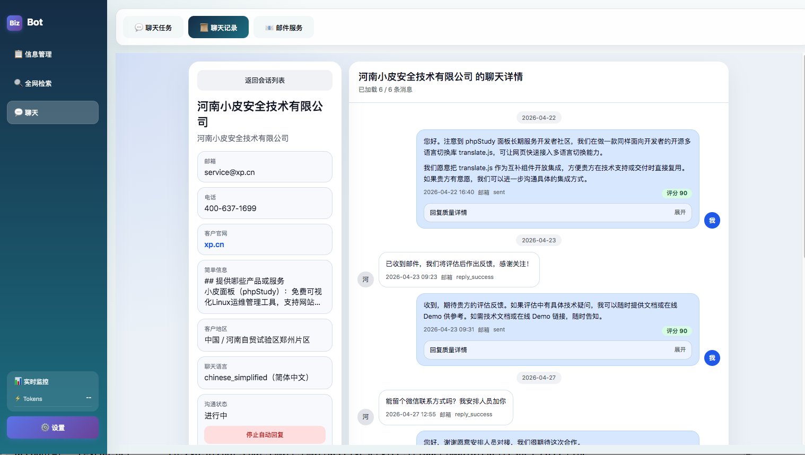
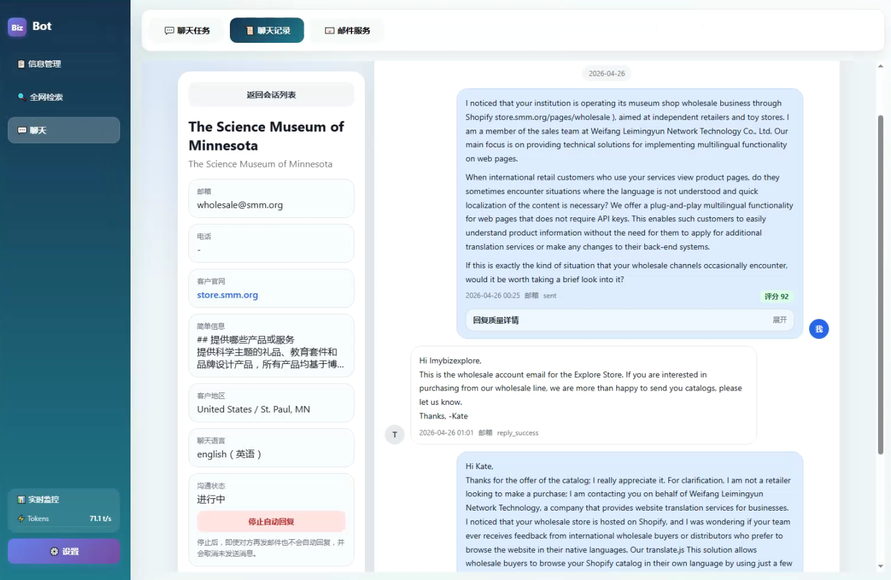
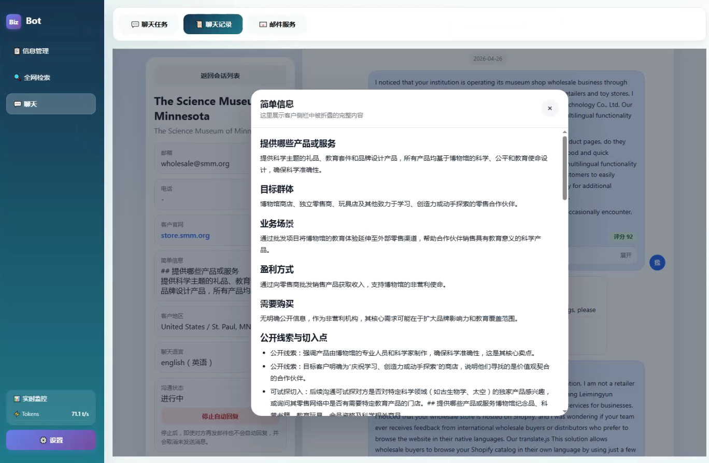

# BizBot AI全自动营销推广机器人
它是一个自动营销推广的机器人。提供全模态的自动化营销推广能力。  
  
1. 全网检索，跟自己有合作、成交、长下游、等关系的目标。
1. 自我进化，用的越久，参与越多，它永久记忆。可自我模拟客户沟通训练。用的时间越长，它聊客户会越像你。
1. 类人处理，完全以人的角度去出发去分析。它代替你去找客户、跟对方聊商机，对方感知你就是一个人。
1. 团队整合，它内置了整个公司团队，包括商机发现、线索梳理、业务沟通、销售主管、技术评估 ... 多角色并行，拒绝群发骚扰。
1. 时间优化，它会在客户的白天或办公时间跟对方沟通，绝不在对方休息时进行骚扰。
1. 

# 私有部署
当前已集成到宝塔中进行一键安装使用，可直接在宝塔中搜索 ````BizBot```` 即可找到，进行安装使用。  


# 使用截图
### Android 端



### WEB端




